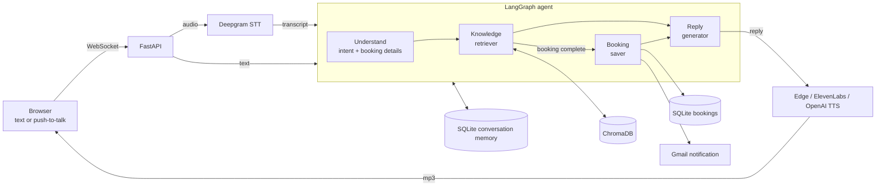

# AI Voice Agent for Appointment Booking

[](https://github.com/abduljalilmemon/voice-agent/actions/workflows/ci.yml)

A voice and text assistant for service businesses. Callers ask questions and book appointments in
natural conversation; the agent answers from the business's own knowledge base, collects booking
details over several turns, saves the booking, and emails the owner.

Built with **LangGraph**, **FastAPI** (WebSockets), **ChromaDB**, **Deepgram** speech-to-text and
pluggable LLM / text-to-speech providers. The included demo business is a dental clinic.


*A real run of the app at 1.5× speed: two questions by text, then a booking made by voice. The panel
on the right is driven by the server's actual events and timings; captions stand in for the audio.
The GIF is generated from code: see [`demo/`](demo/).*

Example flow (the LLM's wording varies from run to run):

```
Caller:  I'd like to book a cleaning
Agent:   Sure! Could I get your full name, please?
Caller:  Sara Khan
Agent:   Thanks, Sara. What date and time would suit you?
Caller:  This Friday at 10am
Agent:   Got it. Could I have a phone number to reach you?
Caller:  0300 1234567
Agent:   You're booked for a cleaning this Friday at 10 AM, Sara. The clinic will call you to confirm.
         → booking saved to the database, owner notified by email
```

## Highlights

- **LangGraph agent with two LLM calls per turn**: one structured call reads the intent *and* any
  booking details, then knowledge-base retrieval, booking save, and the reply. Conversation memory
  persists per session in SQLite.
- **Grounded, honest replies**: booking details are understood and saved *before* the reply, so the
  agent knows exactly what has been collected and never says "you're booked" before it is saved.
- **Measured with evals**, not just eyeballed: an intent-classification eval and a multi-turn
  conversation eval that run against the real LLM ([results](#results)).
- **Concurrent by design**: blocking LLM / speech calls run off the event loop, so one caller never
  stalls another.
- **Hardened API**: admin auth, WebSocket origin checks, per-IP rate limiting, input size limits,
  HTML-escaped notification emails.
- **Fails gracefully**: speech-to-text, LLM and TTS failures reach the caller as a message and the
  connection stays open; the text reply is still delivered when voice fails. Provider rate limits
  are retried, and the browser reconnects on its own if the connection drops.
- **Bookings checked in code**: spoken dates are resolved to real dates, then checked against
  opening hours and existing bookings (no double-booking, even for simultaneous callers).
- **Swappable providers** via `.env`: Groq / Anthropic Claude / OpenAI / Gemini for the LLM;
  Edge TTS (free) / ElevenLabs / OpenAI for speech.
- **Reproducible demo**: the GIF above is recorded from the real app and rendered by a script
  (Puppeteer, Whisper, HyperFrames, Remotion).
- **Tested**: 108 offline unit tests (fake LLMs, a frozen clock, no API keys) and a Docker build in
  GitHub Actions CI.

## Architecture



| Node | What it does |
|---|---|
| Understand | One structured-output LLM call (validated against a Pydantic schema) that labels the latest message (`GREETING`, `FAQ`, `BOOK`, `COLLECT`, `COMPLAINT`, `ESCALATE`, `CONVERSATION`, `OUT_OF_SCOPE`) and pulls out any booking details in it. It sees the last few messages and what's been collected so far, so short answers like "yes" or "Sara Khan" are read in context. New details are merged into the booking in code (a correction overrides the old value), and completeness (name, date, time, phone) is decided in code, not by the LLM. |
| Knowledge retriever | Embeds the question (all-MiniLM-L6-v2 via ONNX Runtime) and keeps only chunks within a calibrated distance cut-off, so off-topic questions get no misleading context. |
| Booking rules | Plain code, not the LLM: spoken dates ("this Friday", "the 14th") are resolved with `dateparser`, then checked against opening hours, appointment length and existing bookings; phone and email are validated. A rejected detail is dropped and the reply is told why ("we're closed on Sundays"). |
| Booking saver | Saves the booking once per conversation, re-checking the slot in the same database transaction so two callers can't take it at once, and emails the owner. |
| Reply generator | One prompt with the business profile, today's date, voice rules and the real booking state. Markdown is stripped before speech. Off-topic and escalation replies are fixed text, with no LLM call. |

## Results

All numbers were measured in this repository; the scripts are in [`evals/`](evals/).

| What | Before | After |
|---|---|---|
| Intent classification accuracy (18 cases × 3 runs, [`intent_eval.py`](evals/intent_eval.py)) | 81% | **100%** |
| Multi-turn conversation checks ([`conversation_eval.py`](evals/conversation_eval.py)) | 77% (24/31) | **100% (22/22)** |
| Replies safe for text-to-speech (no markdown) | 97% | **100%** |
| 4 simultaneous chats, time vs. a single chat | 4.0–6.5× | **1.6×** |
| `/health` response time while those chats run | 0.6–1.2 s | **0.02 s** |
| Knowledge-base lookup per FAQ question | ~1.2 s | **~0.1 s** |
| LLM calls per turn (intent + booking merged into one structured call) | 2.23 | **1.85** |
| Agent time per turn, median (conversation eval) | 1.02 s | **0.79 s** |
| Tokens per turn | 1,419 | **1,360** |

The conversation eval runs scripted chats through the full agent and checks each reply. It checks
that the agent remembers the caller's name, knows which business it is, never claims a booking before
it is saved, gives a real way to reach a human, quotes prices from the knowledge base and refuses
off-topic questions. In the baseline, a recurring Groq error (`tool_use_failed`) crashed some
conversations early, so fewer checks ran.

Merging intent classification and booking extraction cut calls and latency more than tokens: the
merged prompt and its JSON schema are sent on every turn, while the old extractor only ran on
booking turns. Low reasoning effort on the merged call (it only labels one message) is what brought
tokens and latency down, with no change in either eval.

A voice turn measured **6–8 seconds** end to end before the latest agent optimisations: speech-to-text
~1.5–2 s, agent ~2.5 s, speech synthesis ~2–3 s (a few measurements on a home connection). The agent
part is now a median 0.8 s in the conversation eval, so speech-to-text and synthesis dominate. Speech
is not streamed yet; see [Limitations](#limitations).

## Quick start

Requires Python 3.11+ and a [Groq](https://console.groq.com) API key (free tier) for the LLM. Voice
also needs a [Deepgram](https://deepgram.com) key; text chat works without it.

```bash
git clone https://github.com/abduljalilmemon/voice-agent.git
cd voice-agent
python -m venv venv
source venv/bin/activate          # Windows: venv\Scripts\activate
pip install -r requirements.txt

cp .env.example .env              # then add GROQ_API_KEY (and DEEPGRAM_API_KEY for voice)
python -m app.knowledge.ingest    # build the knowledge base
uvicorn app.main:app --reload
```

Open **http://localhost:8000/static/index.html** and use the Text Chat or Voice Chat tab.

### With Docker

```bash
cp .env.example .env              # add your keys
docker compose up --build
```

The container rebuilds the knowledge base from `data/` on every start, runs as a non-root user, has
a health check, and keeps conversations and bookings in a named volume.

## Configuration

All settings live in `.env`; [`.env.example`](.env.example) lists every one. The main ones:

| Variable | Purpose |
|---|---|
| `LLM_PROVIDER` / `LLM_MODEL` | `groq` (default, `openai/gpt-oss-20b`), `anthropic` (`claude-haiku-5-5`), `openai`, `gemini`; `LLM_MODEL` overrides the model |
| `TTS_PROVIDER` | `edge` (free, default), `elevenlabs`, `openai` |
| `DEEPGRAM_API_KEY` | Speech-to-text for voice chat |
| `OWNER_EMAIL`, `GMAIL_USER`, `GMAIL_APP_PASSWORD` | Booking notification emails (skipped if unset) |
| `ADMIN_API_KEY` | Required `X-API-Key` header for `GET /bookings` (endpoint disabled if unset) |
| `CORS_ORIGINS`, `RATE_LIMIT_PER_MINUTE` | Extra allowed browser origins; agent turns per minute per IP (default 20) |
| `LOG_LEVEL` | `INFO` by default; `DEBUG` also logs messages, transcripts and booking data |

### Using it for another business

1. Edit [`data/business_config.json`](data/business_config.json) with the business name, type,
   address, phone, email, timezone, appointment length and opening hours per weekday (`null` for
   closed days). These go into every reply, are searchable, and decide which slots can be booked.
2. Replace [`data/knowledge_base/dental_clinic.txt`](data/knowledge_base/dental_clinic.txt) with the
   business's services, prices, policies and FAQs, as paragraphs separated by blank lines.
3. Re-run `python -m app.knowledge.ingest` (Docker does this on start).

## API

| Method | Endpoint | Description |
|---|---|---|
| `POST` | `/chat` | One chat turn: `{"message": "...", "session_id": "optional"}` |
| `WS` | `/ws/{session_id}` | Text chat. Send `{"message": "..."}`, receive `typing` / `message` / `error` events |
| `WS` | `/ws/voice/{session_id}` | Voice chat. Send recorded audio (webm), receive `status`, `transcript`, `reply`, `audio` (base64 mp3) and `error` events |
| `GET` | `/bookings` | All bookings. Requires `X-API-Key: <ADMIN_API_KEY>` |
| `GET` | `/health` | Health check |
| `GET` | `/docs` | Interactive OpenAPI docs |

```bash
curl -X POST localhost:8000/chat -H "Content-Type: application/json" \
     -d '{"message": "how much is teeth whitening?"}'

curl localhost:8000/bookings -H "X-API-Key: $ADMIN_API_KEY"
```

## Development

```bash
pip install -r requirements-dev.txt
pytest                 # 108 tests, offline: fake LLMs, temp storage, no API keys or email
ruff check .

# evals call the real LLM configured in .env and use API credits
python evals/intent_eval.py 3
EVAL_TURN_DELAY=25 python evals/conversation_eval.py 2   # the delay keeps Groq's free tier under its rate limit
```

CI ([`.github/workflows/ci.yml`](.github/workflows/ci.yml)) runs lint, the tests and a Docker image
build on every push and pull request. Manual scripts that do hit real services (send a test email,
chat in the terminal, check voice keys) are in [`scripts/`](scripts/).

```
app/
  agent/          LangGraph graph, state and nodes (understand, retriever, booking saver, responder)
  knowledge/      knowledge-base ingestion and retrieval (ChromaDB)
  voice/          speech-to-text (Deepgram) and text-to-speech providers
  integrations/   booking storage (SQLite) and email notifications
  main.py         FastAPI app: REST + WebSocket endpoints
  security.py     admin auth, origin checks, rate limiting, input limits
  llm.py          LLM provider factory
data/             business config + knowledge base
frontend/         browser UI (text + voice)
evals/            LLM evals with real API calls
tests/            offline unit tests
scripts/          manual checks against real services
```

## Limitations

These are known gaps, listed here rather than hidden:

- **Voice is push-to-talk and not streamed**: the whole recording is transcribed, then the whole
  reply is synthesised, which is why a turn takes several seconds.
- **Bookings are checked against opening hours and each other, not a real calendar**: each
  conversation can make one booking, and it can't be changed in the chat. Rare date phrasings
  ("next week Tuesday") aren't understood; the agent then asks for the date again.
- **Single-instance storage**: SQLite and the in-memory rate limiter work for one server process.
  Behind a reverse proxy, the rate limiter would need the real client IP from proxy headers.
- **Groq free tier**: a turn uses about 1,400 tokens over two LLM calls, and the free tier allows
  8,000 tokens per minute (roughly five turns a minute), so a paid tier is needed for real traffic.
- The OpenAI and Gemini default model names are configurable but not verified against live APIs.

## Roadmap

- [ ] Streaming speech-to-text and text-to-speech, with interruption and no push-to-talk
- [ ] Google Calendar integration for real appointment slots
- [ ] Twilio integration for real phone calls
- [ ] Per-stage latency metrics
- [ ] PostgreSQL for multi-instance deployments
